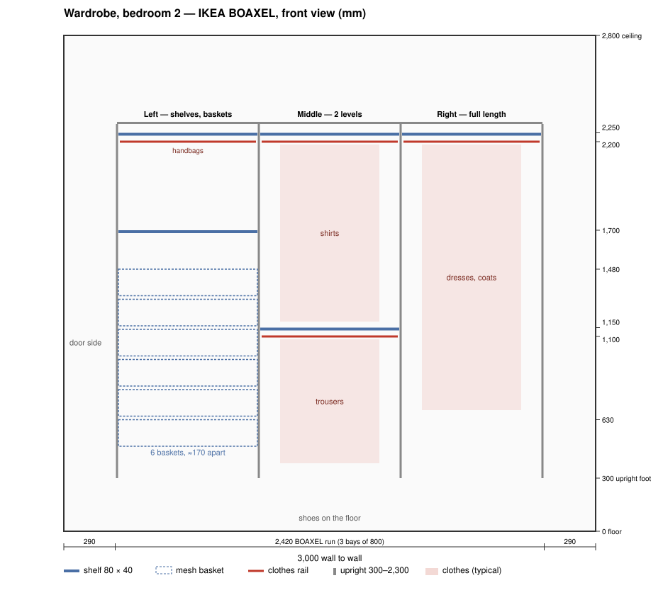

# Wardrobe, bedroom 2 — IKEA version

Date: 5 Nov 2026

An open wardrobe in bedroom 2, 3 m wide, with a curtain in front, using IKEA's BOAXEL system on the back wall. IKEA delivers and installs it. The alternative to the [steel-rail version](README.md).

## Size

| | mm |
|---|---|
| Width, wall to wall | **3,000** |
| Floor to ceiling | **2,800** |
| Shelf depth | **400** |
| Curtain track, from the back wall | **550** |

## Layout

4 uprights on the back wall make 3 bays: **80 + 80 + 80 cm**, centred on the wall. IKEA's [BOAXEL buying guide](https://www.ikea.com/gb/en/files/pdf/39/85/39853faa/fy26-boaxel_buying_guide_a4-final.pdf) adds 1 cm at each end for the outside uprights, so the whole run is 1 + 240 + 1 = **242 cm**, leaving **29 cm at each end** of the 300 cm wall.

Facing the wardrobe:

| | Left bay — full length | Middle bay — 2 levels | Right bay — shelves and baskets |
|---|---|---|---|
| ≈2,100 | shelf | shelf | shelf |
| ≈2,050 | clothes rail — dresses, long coats | clothes rail — shirts, jackets | clothes rail — handbags, short things |
| ≈1,600 | | | shelf |
| ≈1,480 | | | **mesh basket** |
| ≈1,310 | | | **mesh basket** |
| ≈1,140 | | | **mesh basket** |
| ≈1,000 | | shelf | |
| ≈970 | | | **mesh basket** |
| ≈950 | | clothes rail — trousers | |
| ≈800 | | | **mesh basket** |
| ≈630 | | | **mesh basket** |
| ≈460 | | | **mesh basket** |
| Floor | shoes | shoes | shoes |

- **Left bay** (next to the door): full length, for dresses and long coats — hanging needs no room in front.
- **Middle bay:** shirts and jackets above, trousers below.
- **Right bay** (next to the window): shelves up high, 7 mesh baskets below, about 170 apart. The baskets pull out toward you, and the floor in front of the window is free to stand in.
- **Every top rail is at 2,050**, an easy reach at 173 cm. Shoes go on the floor under every bay.
- Heights are from the floor, at the nearest slot in the uprights (150–2,150); they can be changed later — the brackets click in with no tools.
- **Brackets:** each clothes rail hangs on hooks clipped to the brackets of the shelf above it; each shelf and basket has its own pair, shared with the next bay where the heights line up — 22 in all.

## Parts (IKEA Thailand)

| Item | Product | Article | How many | Status | Each | Total |
|---|---|---|---|---|---|---|
| Wall upright | [BOAXEL, white, 200 cm](https://www.ikea.com/th/en/p/boaxel-wall-upright-white-60453569/) | 604.535.69 | 4 | To buy | ฿300 | ฿1,200 |
| Mounting rail | [BOAXEL, white, 182 cm](https://www.ikea.com/th/en/p/boaxel-mounting-rail-white-80474274/) — cut the second to fit | 804.742.74 | 2 | To buy | ฿150 | ฿300 |
| Shelf 80 × 40 | [BOAXEL, white](https://www.ikea.com/th/en/p/boaxel-shelf-white-80453554/) | 804.535.54 | 5 | To buy | ฿450 | ฿2,250 |
| Mesh basket 80 × 40 × 15 | [BOAXEL, white](https://www.ikea.com/th/en/p/boaxel-mesh-basket-white-10459955/) | 104.599.55 | 7 | To buy | ฿400 | ฿2,800 |
| Bracket, 40 cm | [BOAXEL, white](https://www.ikea.com/th/en/p/boaxel-bracket-white-40453513/) | 404.535.13 | 22 | To buy | ฿55 | ฿1,210 |
| Clothes rail, 80 cm | [BOAXEL, white](https://www.ikea.com/th/en/p/boaxel-clothes-rail-white-50453517/) | 504.535.17 | 4 | To buy | ฿125 | ฿500 |
| | | | | **To buy** | | **฿8,260** |

Prices checked on IKEA Thailand 2026-11-05; every part "Available for delivery".

**Wall screws and plugs** — not included with any BOAXEL part (IKEA's instructions: "Screw(s) and plug(s) for the wall are not included"). About 40 holes in the brick: mounting rails 5 + 3 screws, each upright 8.

| Item | Product | HomePro SKU | How many | Status | Each | Total |
|---|---|---|---|---|---|---|
| Pan-head screws, #6 × 1½" (3.5 × 38 mm) | [DEXZON TP, pack of 25](https://www.homepro.co.th/p/1174023) | 1174023 | 2 packs | To buy | ฿29 | ฿58 |
| Wall plugs, no. 6 | [DEXZON plastic plugs, pack of 100](https://www.homepro.co.th/p/1207167) | 1207167 | 1 pack | To buy | ฿49 | ฿49 |
| | | | | **To buy** | | **฿107** |

HomePro, checked 2026-11-05. **The holes in the rails and uprights are small:** IKEA's instructions call for **pan-head screws** (not countersunk) with a head **7 mm across for the mounting rails** and **8 mm for the uprights** (pages 13–14 and 17). A #6 (3.5 mm) pan-head screw has a head of about 7 mm, so one size fits both; the no. 6 plug is the matching size.

## Installation

IKEA installs it on the day the truck delivers — book it when ordering online, or at the Delivery Counter in store.

| | IKEA's rate | For this wardrobe |
|---|---|---|
| Assembly | 7% of the regular price | ≈฿578 |
| Wall mounting | ฿50 per 4 holes | ≈฿500 (about 40 holes) |
| Truck delivery | from ฿299, by delivery area | from ฿299 — the exact fee for Si Racha shows at checkout |

From IKEA Thailand's [assembly service](https://www.ikea.com/th/en/customer-service/services/assembly) and [delivery](https://www.ikea.com/th/en/customer-service/services/delivery) pages, checked 2026-11-05. Questions: LINE **@IKEAThailand** — [line.me/R/ti/p/@IKEAThailand](https://line.me/R/ti/p/@IKEAThailand) — 9:00–21:30.

## Total

| | |
|---|---|
| Parts (IKEA) | ฿8,260 |
| Wall plugs and screws (HomePro) | ฿107 |
| Assembly and wall mounting | ≈฿1,080 |
| Truck delivery | from ฿299 |
| **Total** | **≈฿9,750** or a little more |

## Check before ordering

- **Slot spacing:** IKEA doesn't publish the spacing of the slots in the uprights.
- **Screws:** check in store that the DEXZON TP heads are no wider than 7 mm.

## Sources

- [IKEA – BOAXEL buying guide (FY26, PDF)](https://www.ikea.com/gb/en/files/pdf/39/85/39853faa/fy26-boaxel_buying_guide_a4-final.pdf), read 2026-11-05: the 1 cm end allowance.
- [IKEA – BOAXEL wall upright and mounting rail assembly instructions, AA-2341341-2](https://www.ikea.com/th/en/assembly_instructions/boaxel-wall-upright-white__AA-2341341-2-100.pdf), linked from the IKEA Thailand product pages, read 2026-11-05: screws per rail (pages 13–15) and per upright (page 18), screw heads (pages 13–14 and 17).
- IKEA – BOAXEL [clothes rail](https://www.ikea.com/th/en/assembly_instructions/boaxel-clothes-rail-white__AA-2184889-3-2.pdf) (AA-2184889) and [mesh basket](https://www.ikea.com/th/en/assembly_instructions/boaxel-mesh-basket-white__AA-2200079-2-2.pdf) (AA-2200079) assembly instructions, read 2026-11-05: the rail clips onto the shelf's brackets; the basket's runners take their own pair.
